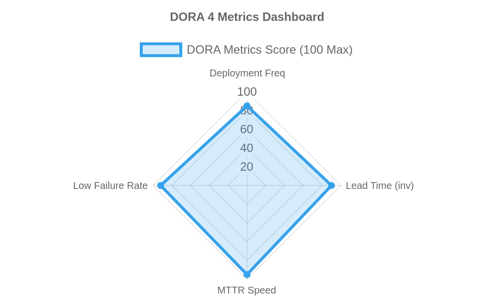

# [학기 프로젝트] test-repo

## 📊 DORA 4대 지표 자동화 대시보드 (주간 리포트)
> **최종 갱신 일시**: `2026-10-26 03:16:10 UTC`

### 📈 세부 지표 수치

| 지표명 (Metric) | 측정값 (Value) | 등급 (Status) |
| :--- | :--- | :--- |
| **Deployment Frequency** (배포 빈도) | 14 회/주 | High |
| **Lead Time for Changes** (변경 리드타임) | 3.5 시간 | High |
| **Mean Time to Restore** (평균 복구 시간) | 22 분 | Elite |
| **Change Failure Rate** (변경 실패율) | 2.8 % | Elite |

---
*본 대시보드는 GitHub Actions를 통해 주간 단위로 수집 및 갱신되며, 상세 데이터는 `dora-metrics.json` 아티팩트로 저장됩니다.*
